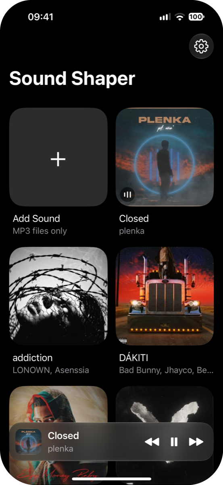
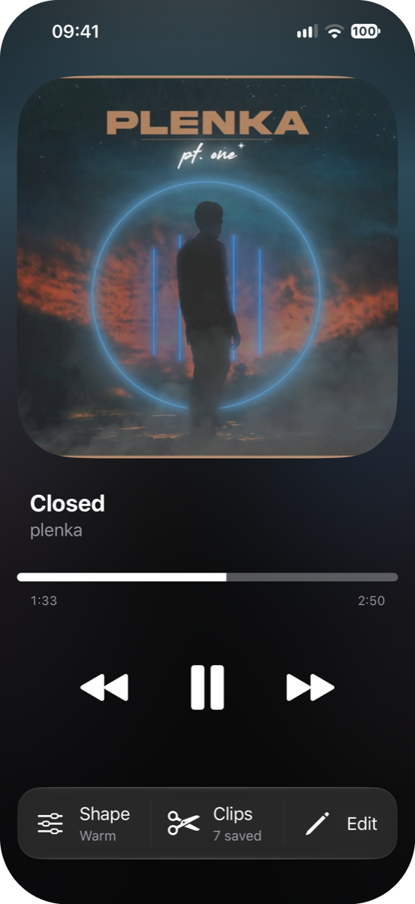
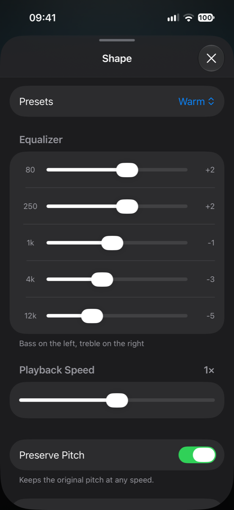
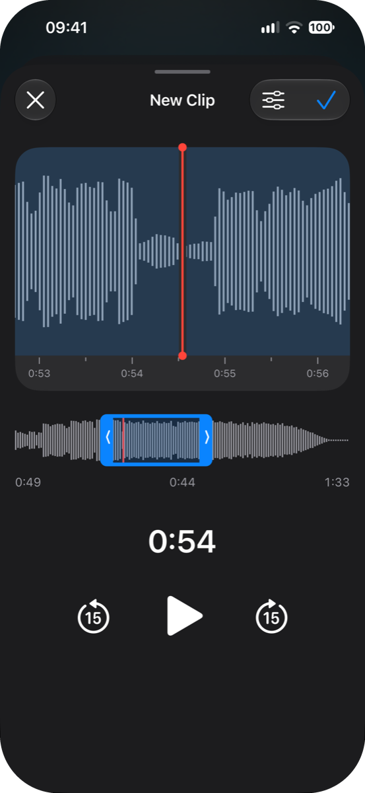

# Hi · Hola · 你好, I'm Juan Villa

**Software developer** from Venezuela. I build native mobile apps and web products, and I build them the way I play games: going for the platinum.

Since 2022 I've worked remotely for companies in Mexico, most of all [Crol](https://www.crol.mx), a cloud ERP for small and mid-sized businesses. I'm also the technical co-founder of [Salvalo](https://salvalo.app). On my own time I build my own apps: tools I use every day, with the flows I wish other apps had. All of it, told in my own voice, is at [juanevillam.com](https://juanevillam.com).

## My apps

### Sound Shaper

A music player for your own MP3s, shaped the way you want them to sound. Built native for iPhone, and live on the [App Store](https://apps.apple.com/app/id6823850995).

- **Make every song yours.** Change the speed live, set a five-band equalizer or a preset, and add effects like Preserve Pitch, Echo and Next Room.
- **Keep the part you love.** Save your favorite seconds as clips and loop them anytime.
- **Always with you.** Your library lives on your phone and works offline, with a Home Screen widget, and Lock Screen and Dynamic Island controls.
- **A little extra.** PlayStation-style trophies, all the way to the platinum.

  
  
  
  

The story, in my own voice: [juanevillam.com/sound-shaper](https://juanevillam.com/sound-shaper).

### Space Explorer

A 3D space shooter that fits in 50 KB, built for [Platanus Hack](https://hack.platan.us/26-ve)'s arcade challenge. It started as an easter egg I planned for Sound Shaper, and I took it out to keep the app simple. [Play it here](https://hack.platan.us/26/arcade/space-explorer).

## Tridi

Tridi turns an ordinary phone video of a person into movement data for humanoid robots: a simulated robot learns the movement by imitating you, practicing with real physics across different terrains until it stops falling, and the trained model comes out ready for real hardware. It started at [Platanus Hack 26: Caracas](https://juanevillam.com/events/platanus-hack-caracas-2026-10), built by a team of four in 36 hours, and it keeps going. [Try the demo](https://tridi-alpha.vercel.app).

## Work

**Lead Frontend Developer · Crol** (Feb 2022 – present)
I built Crol ERP Móvil from scratch, design included: the mobile app of a cloud ERP that major clients across Mexico run on today, live on the [App Store](https://apps.apple.com/mx/app/crol-erp-m%C3%B3vil/id6743251171) and [Google Play](https://play.google.com/store/apps/details?id=com.crolapp). It grew out of Conto Pay, the group's simpler point of sale, whose web app, mobile app and landing page I built first.

**Co-founder · [Salvalo](https://salvalo.app)** (Jun 2024 – present)
Shops turn the products they still have at closing time into packs with a price and a pickup time; you find one nearby on the map, reserve it, pay the shop and pick it up with a code. Live on the [App Store](https://apps.apple.com/es/app/salvalo/id6759407790) and [Google Play](https://play.google.com/store/apps/details?id=com.grostify.salvalo), piloting in Barquisimeto, Venezuela. As the technical co-founder I redesigned the app, for customers and for shops, and built the new website, which the team edits without code. I also represent Salvalo in Venezuela: pitching to shops and at events.

## Sites I built

- [salvalo.app](https://salvalo.app): Salvalo's landing page
- [contopay.lat](https://www.contopay.lat): Conto Pay's landing page, a mobile point of sale from the Crol group
- [maktubartfund.com](https://maktubartfund.com): an art investment fund in Mexico, fully editable by the client through a CMS

## Stack

`TypeScript` `React Native` `Expo` `SwiftUI` `Jetpack Compose` `Next.js` `React` `Astro` `Redux` `Firebase` `Cloudflare Workers` `C++` `Figma`

## Contact

[juanevillam.com](https://juanevillam.com) · [LinkedIn](https://linkedin.com/in/juanevillam) · [Instagram](https://instagram.com/juanevillam)
